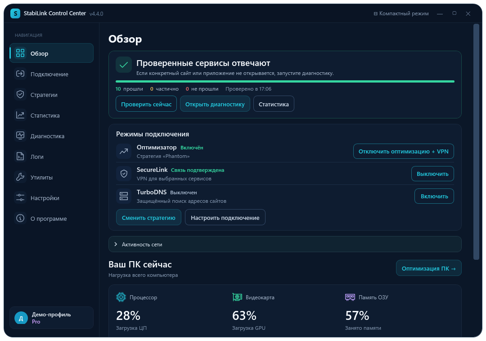
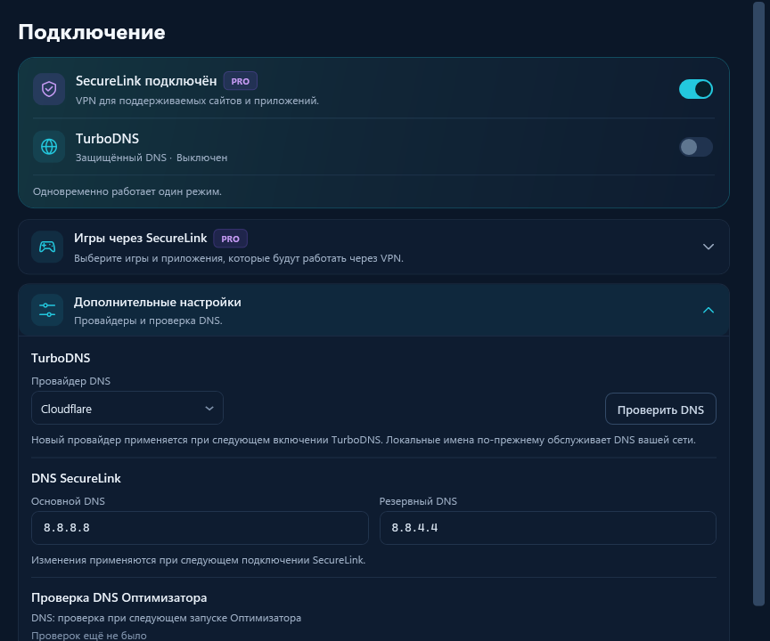
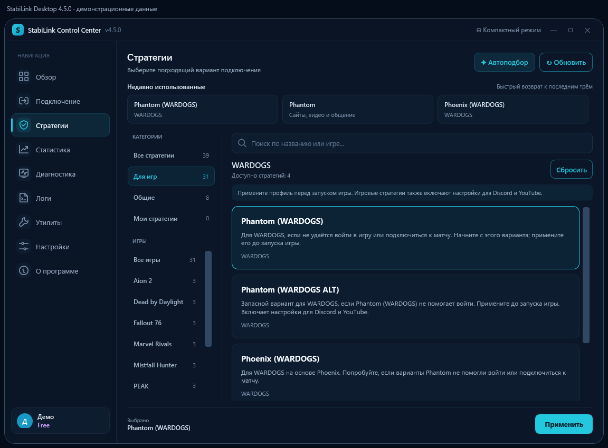
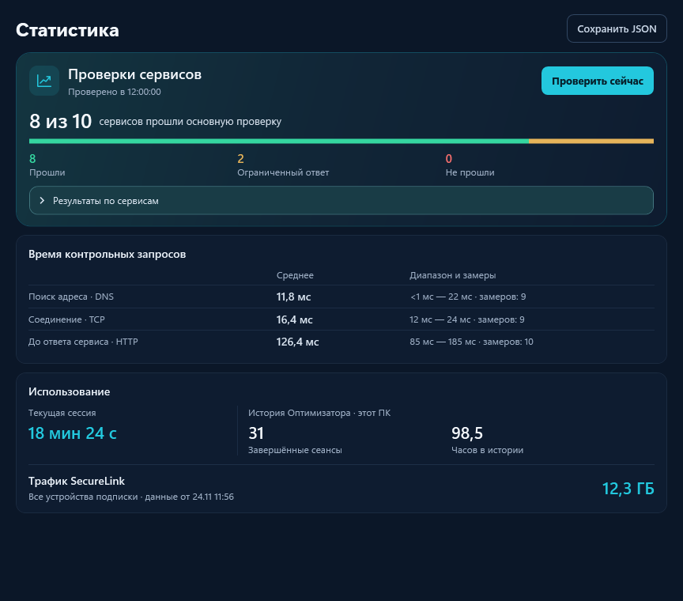
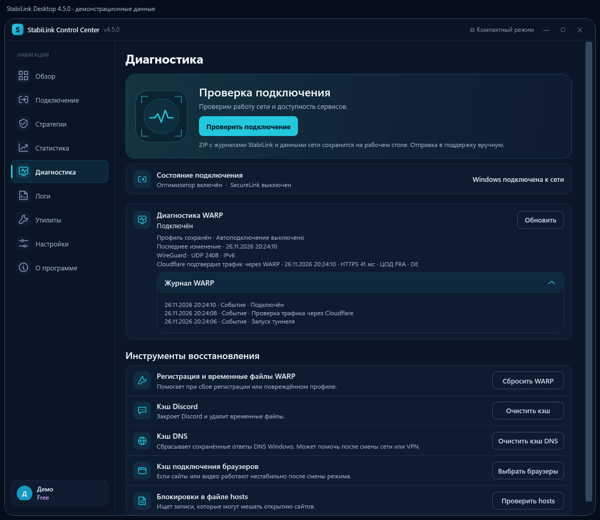
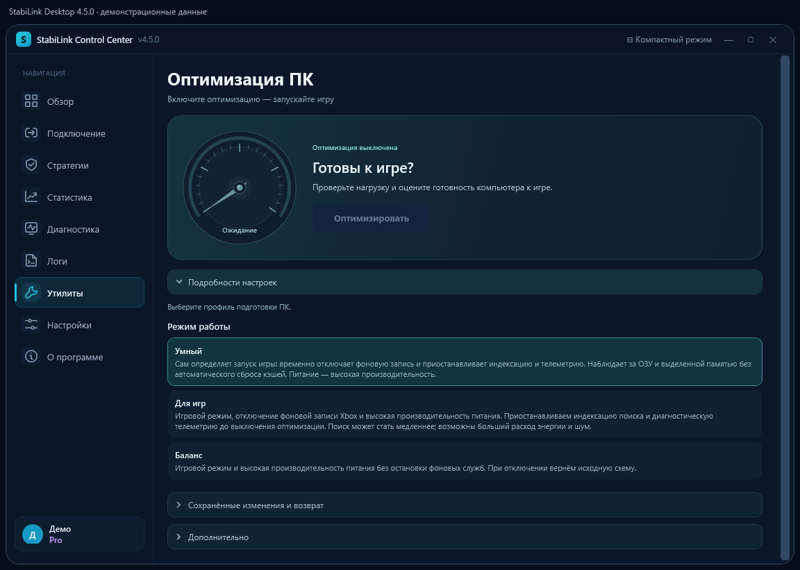
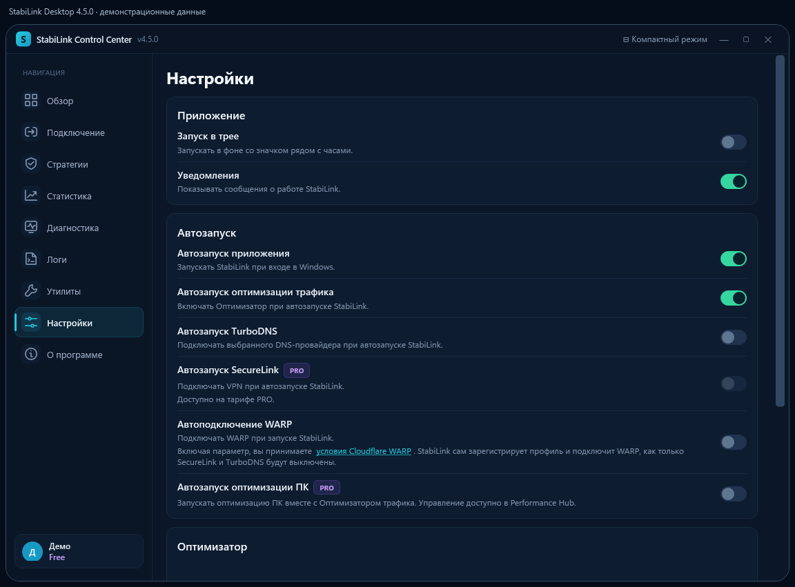

# StabiLink Control Center: полный обзор

[Все руководства](../README.md#docs) · [Игры](../README.md#games) · [Релизы](https://github.com/sany86russ/StabiLink-Desktop/releases/latest) · [Поддержка](../SUPPORT.md)

Содержание

- [Обзор](#обзор)
- [Подключение](#подключение)
- [Стратегии](#стратегии)
- [Статистика](#статистика)
- [Диагностика](#диагностика)
- [Логи](#логи)
- [Утилиты](#утилиты)
- [Настройки](#настройки)
- [Профиль](#профиль)
- [О программе](#о-программе)
- [DNS и маршрутизация](#dns-и-маршрутизация)

Control Center — расширенный режим StabiLink Desktop. Он объединяет управление подключением, стратегиями, статистикой, диагностикой, журналами, утилитами и настройками.

## Обзор

На главном экране видны активная стратегия, состояние Оптимизатора, SecureLink и TurboDNS. Доступными модулями можно управлять прямо здесь. Кнопка **«Сменить стратегию»** открывает раздел «Стратегии».

Карточка проверенных сервисов показывает время проверки и отличает ограниченный ответ от неудачной проверки. При проблеме можно перейти к диагностике. В блоке **«Активность сети»** отображается входящий и исходящий трафик компьютера или SecureLink в зависимости от режима. Он показывает текущую активность, а для оценки доступности сервисов служат проверки в «Статистике».

В компактном окне есть карточки стратегии, SecureLink, DPI-фильтра и оптимизации ПК. Показатели ПК доступны при подтверждённом Pro. Кнопка **«Расширенный режим»** возвращает в Control Center.

## Подключение

### TurboDNS

TurboDNS передаёт DNS-запросы через шифрованное соединение. Включить его можно на карточке **«TurboDNS»**.

- В **«Дополнительных настройках»** можно выбрать Cloudflare, Quad9, Comss или Xbox DNS. Новый выбор применяется при следующем включении TurboDNS.
- Кнопка **«Проверить DNS»** проверяет работу локального DNS-сервиса и получение ответов. Доступ к конкретному сайту или приложению проверяйте отдельно.
- При смене сети StabiLink проверяет подключение повторно. Локальные имена по-прежнему обслуживает DNS вашей сети.
- TurboDNS доступен Free и Pro. SecureLink и TurboDNS работают по отдельности, поскольку оба управляют DNS.

### SecureLink Tunnel

VPN-режим для пользователей PRO. Он создаёт защищённое подключение и направляет поддерживаемый трафик через SecureLink.

- переключатель подключает и отключает VPN;
- режим может работать отдельно или вместе с Оптимизатором;
- совместный запуск одной кнопкой настраивается в разделе «Настройки»;
- при запуске SecureLink активный TurboDNS корректно отключается.

Подпись **«туннель отвечает»** относится к проверке контрольного адреса. Если другие проверяемые сервисы недоступны, появляется **«Частичный доступ»**; подробности доступны в статистике и диагностике. Ответ контрольного адреса не подтверждает работу всех сайтов, аккаунтов и игровых сессий.

### SecureLink DNS

В **«Дополнительных настройках»** при подтверждённом Pro доступны поля основного и резервного DNS для VPN-режима.

- основной DNS используется первым;
- резервный применяется при недоступности основного;
- рядом показаны примеры распространённых публичных DNS;
- неверный адрес может привести к проблемам с открытием сайтов, поэтому меняйте значения только осознанно.

### Маршрутизация игр и приложений

Выберите установленную игру, её папку или EXE. Настройка доступна при подтверждённом Pro. Автопоиск находит игровые библиотеки и отсеивает установщики, обновления и отчёты об ошибках. Если VPN уже подключён, новые правила применятся при следующем подключении.

## Стратегии

В v4.4.0 доступны **39 встроенных стратегий: 8 общих и 31 игровой профиль для 10 игр**, включая Aion 2 (GLOBAL). Стратегия управляет Оптимизатором трафика; игровой профиль и маршрут SecureLink настраиваются отдельно.

### Категории и поиск

- **«Все стратегии»** — весь каталог.
- **«Для игр»** — выбор игры и её вариантов подключения.
- **«Общие»** — Phantom, Phantom Stealth, Phoenix, Phoenix ALT, Phantom Phoenix, Phantom Phoenix ALT, Vector и Prism.
- **«Мои стратегии»** — пользовательские профили.
- Поиск учитывает название, описание и полное название игры. Запрос `Mistfall Hunter` находит варианты с сокращением MH.
- В узком окне категории и игры представлены компактными списками.
- **«Обновить»** заново получает каталог; **«Применить»** подтверждает выбранную стратегию.

### Игровой каталог

| Игра | Варианты |
|---|---|
| WARDOGS | Phantom (WARDOGS), Phantom (WARDOGS ALT), Phoenix (WARDOGS), Phoenix (WARDOGS ALT) |
| Mistfall Hunter | Phantom (MH), Phoenix (MH), Phantom (MH ALT) |
| PEAK, R.E.P.O., Fallout 76, Rainbow Six Siege, Dead by Daylight, Marvel Rivals, THE FINALS | Для каждой: Phantom (название игры), Phoenix (название игры), Phantom (название игры ALT) |

Все игровые профили доступны FREE и PRO. Они выбираются вручную: **автоподбор сравнивает только 8 общих стратегий**. Примените профиль до запуска игры, затем проверьте вход и матч. Новые профили включают общие настройки Discord и YouTube. THE FINALS ALT сохраняет прямое подключение сервисов игры.

Назначение каждого профиля и симптомы: [каталог игр в README](../README.md#games). Порядок сравнения: [диагностика игрового подключения](MODES.md#games). Наличие профиля не гарантирует работу у любого провайдера и не доказывает причину конкретной ошибки.

### Недавно использованные

Вверху показаны три последние применённые стратегии. История сохраняется после перезапуска; повторное применение поднимает вариант в начало. Нажатие на карточку открывает нужную категорию и выбирает профиль. Чтобы переключиться, нажмите **«Применить»**. Просмотр карточки сам по себе не меняет стратегию; история выбора не является проверкой качества связи.

### Дополнительные настройки Оптимизатора

Автосмена варианта при сбоях, запоминание удачных вариантов и группировка отправки пакетов выключены по умолчанию. Их можно включать вручную и сравнивать по одной; ускоренный движок не требует их включения. История обучения хранится зашифрованной на компьютере. Набор функций зависит от стратегии; изменение настроек применяется при следующем запуске Оптимизатора.

Если текущая стратегия работает стабильно, менять её без причины не требуется. Для Discord или YouTube начните с Phantom и при необходимости используйте автоподбор; для игры сравнивайте её варианты по одному.

## Статистика

- **Проверки сервисов.** Видны время проверки и результат. Раскройте **«Результаты по сервисам»**, чтобы увидеть отдельные ответы. **«Проверить сейчас»** запускает новую проверку.
- **Время ответа.** Показатели DNS, TCP и HTTP относятся к контрольным сервисам. Для игрового пинга смотрите измерение в самой игре.
- **Текущая сессия и история Оптимизатора.** Активный сеанс отделён от завершённых сеансов на этом компьютере.
- **Трафик SecureLink.** Суммарный трафик по устройствам подписки, включая Desktop и Sub URL.
- **«Сохранить JSON».** Сохраняет локальную копию статистики.

## Диагностика

Карточка **«Состояние подключения»** показывает текущий режим. Нажмите **«Проверить подключение»**, чтобы запустить проверку и собрать сведения для поддержки. Приложение показывает этапы сбора и сохраняет ZIP на рабочем столе. Кнопка **«Показать ZIP-отчёт»** помогает найти созданный файл. Отправка выполняется вручную. [Как подготовить материалы для поддержки](PRIVACY_AND_LOGS.md)

### Кэш Discord

StabiLink закрывает Discord перед очисткой временных файлов. После завершения запустите Discord снова и проверьте вход или голосовой канал.

### Кэш DNS

Кнопка **«Очистить кэш DNS»** удаляет устаревшие локальные записи Windows. Это отдельное действие на случай проблем после смены DNS или VPN.

### Кэш подключения браузеров

Нажмите **«Выбрать браузеры»** и отметьте нужные. Перед очисткой закройте выбранные браузеры, чтобы они не восстановили временные данные из памяти.

### Файл hosts

Кнопка **«Проверить hosts»** показывает найденные записи. Если нужно убрать блокировку, отметьте соответствующие строки и нажмите **«Удалить выбранные записи»**. Перед изменением создаётся резервная копия.

## Логи

Раздел показывает последние 100 событий. Их можно искать по тексту и фильтровать по уровню. Автообновление можно поставить на паузу, а кнопка **«Обновить»** читает свежие записи вручную.

Нажмите запись, чтобы скопировать её. **«Сохранить журнал»** экспортирует файл, **«Открыть папку»** открывает каталог. Настройки хранения и очистка доступны в блоке **«Хранение журнала»**. Перед публикацией проверьте содержимое и делитесь только нужным фрагментом.

## Утилиты

### Производительность · PRO

Подготовка ПК к игре: поддерживаемые настройки Windows, производительное питание, наблюдение за памятью и защита ресурсов игры при фоновой нагрузке. Умный режим учитывает запуск и завершение игры. Процент готовности отражает состояние настроек, а не прирост FPS. При отключении возвращаются изменённые параметры.

Автоматических сбросов памяти по таймеру и полной очистки при включении нет. Панель отдельно показывает физическую ОЗУ, выделенную память, доступный запас и крупные потребители. Ручное обслуживание доступно при подтверждённой нехватке и ограничено низкоприоритетным кэшем; память, которую приложения продолжают использовать, оно не освобождает.

### Другие утилиты

Раздел также показывает статус лицензирования Windows и Office и предоставляет связанные системные действия.

- верхние карточки показывают обнаруженный статус Windows и Office;
- «Проверка статуса» обновляет сведения;
- остальные пункты запускают отдельные сценарии для выбранного продукта;
- действия с Windows и Office выполняются отдельно от оптимизации ПК и сетевых модулей.

> [!CAUTION]
> Используйте лицензионные функции только для принадлежащей вам копии Windows/Office и при наличии законного права или действующего ключа. StabiLink не предоставляет лицензию Microsoft и не рекомендует обходить условия правообладателя. Публичная документация намеренно не содержит инструкций по несанкционированной активации.

## Настройки

### Запуск в трее

Открывает приложение свёрнутым в системный трей. Для полного завершения используйте «Выход» в меню трея.

### Уведомления

Включает всплывающие сообщения о запуске и остановке модулей, ошибках и обновлениях.

### VPN вместе с оптимизацией

Опция PRO. Большая кнопка CompactWindow включает и выключает Оптимизатор и SecureLink как единый режим. Если один из модулей не запустился, приложение сообщает об ошибке и сохраняет понятное состояние интерфейса.

### Автозапуск оптимизации ПК · PRO

Подготовка ПК запускается вместе с Оптимизатором трафика при подтверждённом Pro. При его отключении настройки ПК возвращаются. Этот параметр можно выбрать в мастере первого запуска. Ручное включение в Performance Hub работает независимо.

### Game Filter

Дополнительный режим для игровых и голосовых соединений.

- `TCP + UDP` — универсальный вариант;
- `UDP` — только соединения на основе UDP;
- `TCP` — только TCP-соединения;
- поле портов ограничивает обработку указанными портами или диапазонами;
- пустое поле возвращает стандартный набор портов.

Для большинства пользователей рекомендуется оставить `TCP + UDP` и стандартные порты. Неверно заданный диапазон может ухудшить подключение игры.

### Автозапуск приложения

Запускает StabiLink при входе в Windows. Настройка сохраняется между перезапусками.

### Автозапуск оптимизации трафика

Включает Оптимизатор при автозапуске StabiLink.

### Автозапуск TurboDNS

Включает выбранный защищённый DNS при автозапуске StabiLink. Для запуска по входу в Windows выберите один сетевой режим: TurboDNS или SecureLink.

### Автозапуск SecureLink

Подключает VPN при автозапуске StabiLink, когда доступ Pro подтверждён.

## Профиль

Профиль открывается по карточке пользователя в нижнем левом углу Control Center или по кнопке профиля компактного окна.

В нём доступны:

- имя и тариф;
- срок действия PRO;
- общий трафик;
- состояние VPN-доступа;
- занятые и доступные слоты;
- поиск и сортировка устройств. Компьютер, с которого открыт профиль, выделен в списке;
- обновление профиля и выход из аккаунта.

Управление Sub URL удобнее выполнять в веб-кабинете, где для каждого слота доступны копирование ссылки и открытие в совместимом клиенте.

## О программе

Здесь видна версия приложения. **«Открыть диагностику»** ведёт к проверке подключения. Кнопка **«Скопировать сведения»** готовит для поддержки версию StabiLink, версию Windows, архитектуру и среду запуска.

## DNS и маршрутизация

При запуске Оптимизатора выполняется ограниченная проверка DNS. Если проблема подтверждена, приложение проверяет допустимость временного исправления и доступность защищённого DNS. При исправном DNS, активных корпоративных политиках или неподходящем внешнем управлении DNS настройки не меняются. Статус объясняет результат и причину пропуска. Автоматическое исправление можно отключить в настройках.

Временное изменение действует до остановки Оптимизатора. Предусмотрены повторная проверка и возврат собственных изменений, если улучшение не подтверждено. DNS сетевых адаптеров не подменяется этой проверкой. Реальный аварийный сценарий на конкретном ПК требует отдельной проверки; не завершайте процессы принудительно ради эксперимента во время важной сессии.

SecureLink поддерживает IPv4 выбранных приложений и IPv4/IPv6 выбранных доменов или подсетей при поддержке сервера. Правило только для приложения не перенаправляет произвольный IPv6. Прямые исключения сохраняют приоритет. [Режимы и диагностика](MODES.md).
