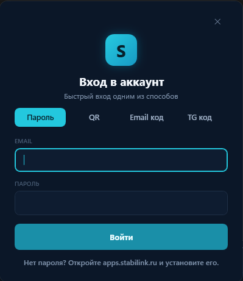
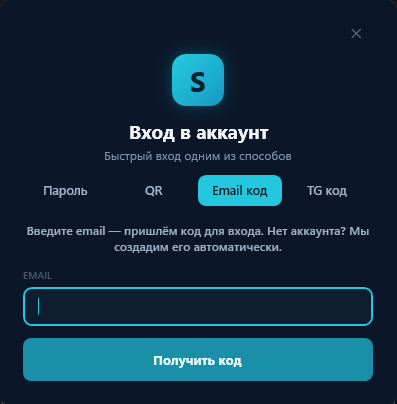
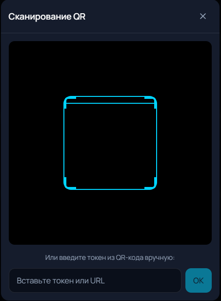
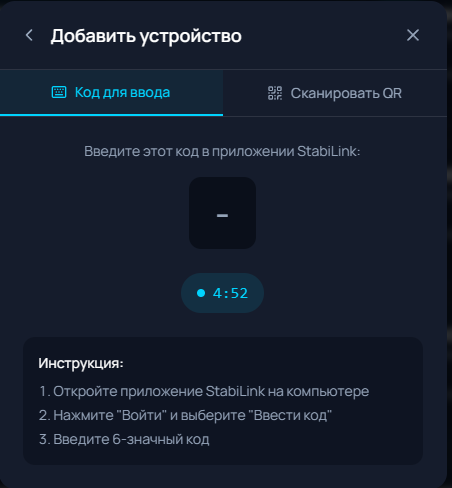
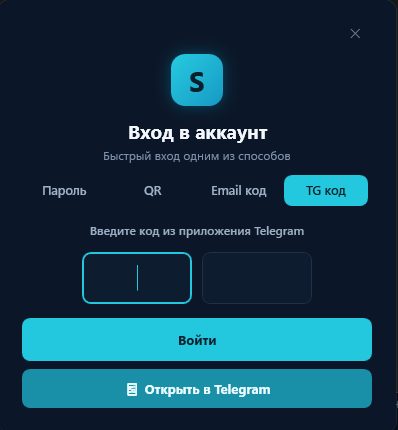

# Первый запуск и авторизация StabiLink Desktop

[Все руководства](../README.md#docs) · [Игры](../README.md#games) · [Релизы](https://github.com/sany86russ/StabiLink-Desktop/releases/latest) · [Поддержка](../SUPPORT.md)

Содержание

- [Самый короткий путь](#самый-короткий-путь)
- [1. Нужно ли сначала регистрироваться?](#1-нужно-ли-сначала-регистрироваться)
- [2. Скачайте и распакуйте приложение](#2-скачайте-и-распакуйте-приложение)
- [3. Пройдите приветствие](#3-пройдите-приветствие)
- [4. Выберите способ входа](#4-выберите-способ-входа)
- [5. Первичная настройка после входа](#5-первичная-настройка-после-входа)
- [6. Если превышен лимит устройств](#6-если-превышен-лимит-устройств)
- [Частые проблемы входа](#частые-проблемы-входа)

Инструкция для тех, кто запускает StabiLink впервые.

## Самый короткий путь

**Для бесплатного Оптимизатора нужен вход в аккаунт, но не покупка PRO.** Если аккаунта ещё нет, его можно создать по почте прямо в Desktop:

1. **[Скачайте ZIP v4.2.7 · 92 МБ](https://github.com/sany86russ/StabiLink-Desktop/releases/download/v4.2.7/StabiLink-Desktop-v4.2.7-win-x64.zip)** и [сверьте SHA-256](INSTALL.md#проверка-sha-256) до запуска. В Проводнике нажмите по ZIP правой кнопкой → **«Извлечь все…»**, затем откройте извлечённую папку. На GitHub выбирайте этот ZIP в **Assets**, а не **Source code**.
2. Запустите **`StabiLink.Desktop.exe`** и подтвердите запрос прав администратора Windows. При скрытых расширениях он показан как **StabiLink.Desktop**, тип **«Приложение»**.
3. Прочитайте соглашение, подтвердите согласие и нажмите **«Начать работу»**. На экране **«Быстрая настройка»** можно выбрать **«Пропустить — настрою вручную»**.
4. В окне входа: **«Email код» → ваша почта → «Получить код» → шесть цифр из письма → «Проверить код»**. У нового пользователя аккаунт создастся автоматически. Если PRO уже оплачен, используйте тот же аккаунт и привязанный email.
5. В компактном окне нажмите **«Расширенный режим»**. Затем **«Стратегии → Для игр» → ваша игра → профиль → «Применить»**. Для WARDOGS начните с **Phantom (WARDOGS)**. Если Центр управления уже открыт, начинайте со «Стратегии».
6. Включите Оптимизатор большой кнопкой и только затем запускайте игру. Для Discord/YouTube начните с обычного Phantom или автоподбора общих стратегий. Для игрового профиля покупать PRO или включать SecureLink не требуется.

При входе компьютер добавляется в аккаунт автоматически. Создавать для него мобильную Sub URL или ссылку Karing не нужно. [Проверка скачивания и подробная установка](INSTALL.md).

## 1. Нужно ли сначала регистрироваться?

**Уже есть PRO? Используйте тот же аккаунт.** Войдите через QR, код устройства или email, уже привязанный в кабинете. Новый email при входе кодом может создать отдельный аккаунт без вашей подписки.

**Нет, не обязательно.** Для входа в Desktop достаточно вкладки «Email код»: аккаунт создастся сам после подтверждения почты.

Регистрация заранее на [apps.stabilink.ru](https://apps.stabilink.ru) удобна, если вы хотите сразу задать пароль или планируете оплатить PRO и подключить телефон. Личный кабинет доступен и в браузере, и внутри Telegram — это одно и то же место с одним аккаунтом, подпиской и списком устройств:

- в браузере: [apps.stabilink.ru](https://apps.stabilink.ru);
- в Telegram: [@stabilink_bot](https://t.me/stabilink_bot) → кнопка «Личный Кабинет» (или сразу [Mini-App](https://t.me/stabilink_bot/staboffice)).

Telegram не обязателен: всё можно сделать через браузер и почту.

> [!IMPORTANT]
> Не передавайте другим людям пароль, коды входа, QR-коды и персональные Sub URL. Поддержка StabiLink никогда не просит прислать пароль или полную ссылку подписки.

## 2. Скачайте и распакуйте приложение

1. **[Скачайте готовый ZIP v4.2.7](https://github.com/sany86russ/StabiLink-Desktop/releases/download/v4.2.7/StabiLink-Desktop-v4.2.7-win-x64.zip)**. Если открыли [страницу релиза](https://github.com/sany86russ/StabiLink-Desktop/releases/tag/v4.2.7), раскройте **Assets** и выберите **StabiLink-Desktop-v4.2.7-win-x64.zip**. Архивы **Source code** содержат документацию.
2. Сверьте SHA-256 со значением в описании этого же релиза — см. [Установка](INSTALL.md#проверка-sha-256).
3. В Проводнике нажмите по ZIP правой кнопкой → **«Извлечь все…»** и распакуйте всё в постоянную папку.
4. Откройте извлечённую папку и запустите **`StabiLink.Desktop.exe`**. При скрытых расширениях это **StabiLink.Desktop**, тип **«Приложение»**. Папки **`bin`**, **`lists`** и **`Resources`** должны остаться рядом.
5. Подтвердите запрос прав администратора Windows. Отдельно устанавливать .NET не нужно.

Не запускайте EXE из ZIP и не переносите его отдельно от остальных файлов. Если приложение не запускается, сохраните точную ошибку и обратитесь в [поддержку](../SUPPORT.md); не отключайте защиту Windows и не скачивайте отдельные DLL из чужих сборок.

## 3. Пройдите приветствие

При первом запуске StabiLink покажет возможности приложения, системные требования и пользовательские условия. Прочитайте условия; если согласны, поставьте флажок и нажмите **«Начать работу»**.

Затем откроется **«Быстрая настройка»**. Для ручного выбора игрового профиля можно нажать **«Пропустить — настрою вручную»**. Если выбрали **«Настроить автоматически»**, дождитесь завершения и нажмите **«Готово»**. Автоподбор общих стратегий в мастере не заменяет выбор профиля вашей игры.

TurboDNS при первичной настройке намеренно **не включается** — его можно включить позже в разделе «Подключение», когда убедитесь, что обычная оптимизация работает.

## 4. Выберите способ входа

Окно входа содержит четыре вкладки: **«Пароль»**, **«QR»**, **«Email код»** и **«TG код»**. Все они ведут в один и тот же аккаунт — разница только в удобстве.

| Ваша ситуация | Вкладка | Почему |
|---|---|---|
| Впервые открыли StabiLink, аккаунта ещё нет | **Email код** | Аккаунт создастся сам, пароль не нужен |
| Аккаунт уже есть, пароль помните | **Пароль** | Самый быстрый вход |
| Пароль не помните или лень печатать | **Email код** | Новый код на ту же почту |
| Телефон рядом, кабинет уже открыт | **QR** | Не нужно ничего вводить с клавиатуры |
| Пользуетесь ботом в Telegram | **TG код** | Код берётся в кабинете |

### Вкладка «Email код» — рекомендуем для первого входа

1. Откройте вкладку «Email код».
2. Введите действующий email — даже если никогда не регистрировались в StabiLink.
3. Нажмите «Получить код».
4. Откройте письмо от StabiLink и введите код из шести цифр.
5. Нажмите **«Проверить код»** — после получения письма так называется прежняя кнопка «Получить код».

Если email используется впервые, аккаунт создастся автоматически. При следующих запусках можно снова ввести ту же почту и получить новый код.

Код действует ограниченное время. Письмо не пришло — проверьте папки «Спам» и «Рассылки» и запросите код заново. Никому не сообщайте полученный код.

### Вкладка «Пароль»

1. Введите email от личного кабинета.
2. Введите пароль.
3. Нажмите «Войти».

Пароля нет? Так бывает, если аккаунт создан автоматически по email-коду или через Telegram. Задайте пароль в личном кабинете на [apps.stabilink.ru](https://apps.stabilink.ru) либо войдите по email-коду. Забыли пароль — [восстановите его](https://apps.stabilink.ru/forgot-password).

### Вкладка «QR»

QR-код в StabiLink — это обычная ссылка. Её открывает **любая камера**, отдельное приложение-сканер не нужно.

**Если телефон под рукой:**

1. Откройте вкладку «QR» и дождитесь появления кода.
2. Наведите на него камеру телефона.
3. Откройте появившуюся ссылку — это страница подтверждения.
4. Сравните эмодзи на телефоне с теми, что показывает Desktop.
5. Подтвердите вход **только при полном совпадении**.

**Если телефона нет:** нажмите кнопку **«🖥 Открыть в браузере на этом ПК»** — страница подтверждения откроется прямо здесь, и телефон вообще не понадобится.

QR действует 5 минут; таймер виден под кодом. Истёк — нажмите «Обновить QR».

> [!CAUTION]
> Эмодзи защищают от подмены. Не подтверждайте вход, если комбинации различаются или если вы сами не запускали добавление устройства.

Подтвердить вход можно и через кабинет: «Устройства» → «StabiLink.Desktop» → «Получить код для подключения» (или «Добавить ещё устройство») → «Сканировать QR».

### Вкладка «TG код»

Код состоит из шести цифр и вводится в два поля по три цифры.

На главной кабинета также есть действие **«Зарегистрировать Windows»**.

1. Откройте личный кабинет: [apps.stabilink.ru/devices](https://apps.stabilink.ru/devices) или [Mini-App в Telegram](https://t.me/stabilink_bot/staboffice).
2. «Устройства» → «StabiLink.Desktop» → «Получить код для подключения» (или «Добавить ещё устройство»).
3. Откройте вкладку «Код для ввода».
4. В Desktop выберите «TG код» и введите показанные цифры.
5. Нажмите «Войти».

Вкладка называется «TG код» по историческим причинам, но Telegram не нужен: код одинаково выдаётся и в веб-кабинете.

## 5. Первичная настройка после входа

Рекомендуемые значения для большинства:

- Game Filter — оставить включённым;
- TurboDNS — не включать, пока не проверили обычную оптимизацию;
- уведомления — включить;
- запуск в трее — по желанию;
- PRO: «VPN вместе с оптимизацией» — по желанию.

Затем:

1. Если открыто компактное окно, нажмите **«Расширенный режим»**. Для Discord и YouTube начните со стратегии **Phantom**. Для игры откройте **«Стратегии → Для игр»**, выберите игру и профиль, нажмите **«Применить»** до запуска игры. Для WARDOGS начните с **Phantom (WARDOGS)**. [Каталог 9 игр](../README.md#games).
2. Нажмите большую кнопку включения.
3. Дождитесь уведомления об успешном запуске.
4. Проверьте нужный сайт, игру или голосовую связь.
5. Для Discord/YouTube при необходимости запустите **«Автоподбор»**. Для игры сравнивайте следующие профили этой же игры вручную по одному: автоподбор тестирует только общие стратегии.

## 6. Если превышен лимит устройств

Текущий лимит, занятые и доступные места показаны в личном кабинете. Компьютер, телефон с приложением StabiLink и **каждый** слот Sub URL занимают по одному месту.

Чтобы освободить место:

1. Откройте «Устройства» в личном кабинете.
2. Найдите старое или неиспользуемое устройство.
3. Удалите или отключите его.
4. Повторите вход на новом компьютере.

## Частые проблемы входа

### Пароль не подходит

Проверьте раскладку клавиатуры и правильность email. Если аккаунт создавался по email-коду, пароля может не быть вообще — войдите по коду или задайте пароль в кабинете.

### QR не сканируется

Увеличьте яркость экрана, протрите объектив камеры, нажмите «Обновить QR». Либо вообще обойдитесь без телефона — кнопка «🖥 Открыть в браузере на этом ПК».

### Код истёк

Коды и QR живут ограниченное время. Запросите новый и вводите только последнее полученное значение.

### Письмо с кодом не приходит

Проверьте «Спам» и «Рассылки», убедитесь в правильности адреса, запросите код повторно ссылкой «Отправить код повторно».

### Устройство не появилось в кабинете

Обновите раздел «Устройства», проверьте лимит тарифа и убедитесь, что подтверждали именно текущую сессию Desktop.

### Telegram недоступен

Telegram не нужен ни для входа, ни для оплаты. Используйте [apps.stabilink.ru](https://apps.stabilink.ru) и вход по email.

English installation and account guidance: [README → English](../README.md#english).
